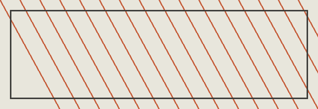

# Parchment sample

This file shows what the reader can display. Edit it in any editor and the view updates when you save. Use the **Theme** control (browser) or the **Appearance** menu (app) to change the theme.

## Text

Body text uses the system sans-serif face. You can write **bold**, *italic*, ~~strikethrough~~, and `inline code`. A [link to the Parchment notes](other.md) opens in this window. Use Back (`Cmd+[`) to return. An [external link](https://example.com) opens in your browser.

> A block quote sits behind a thin rule. It can hold more than one paragraph.
>
> It can also hold `code` and **emphasis**.

## Lists

- A bullet list
  - A nested item
  - A second nested item
- Another bullet
  1. An ordered list inside a bullet
  2. The second step

1. First
2. Second
3. Third

- [x] A finished task
- [ ] An open task

## Code

```python
from pathlib import Path

def count_words(path: Path) -> int:
    """Return the number of words in a file."""
    return len(path.read_text(encoding="utf-8").split())

print(count_words(Path("sample.md")))
```

```bash
# Build the app and open a file
npm install
npm start -- ~/Documents/notes.md
```

```sql
SELECT customer_id, SUM(amount) AS total
FROM orders
WHERE created_at >= DATE '2026-01-01'
GROUP BY customer_id
ORDER BY total DESC;
```

```json
{ "name": "parchment", "version": "1.0.0", "private": true }
```

```
A fence with no language shows as plain text.
```

## Table

| Tool    | Platform        | Install size | Notes                       |
| ------- | --------------- | -----------: | --------------------------- |
| Browser | Any             |       260 KB | Open `parchment.html`       |
| App     | macOS, Linux, Windows | 200 MB | Live reload, file association |

## Image



## Details

<details>
<summary>Raw HTML is cleaned before display</summary>

The `details` element works. Scripts, styles, and forms do not.

<script>document.title = "pwned"</script>


</details>

---

Press <kbd>Cmd</kbd> + <kbd>O</kbd> to open another file.
